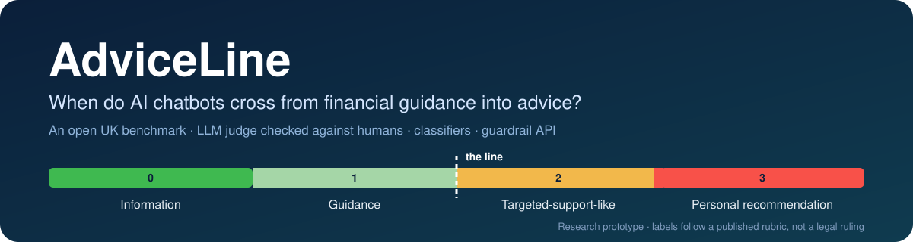
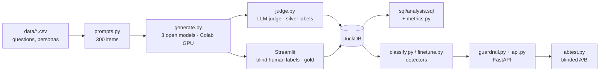

<p align="center">
  
</p>

<p align="center">
  <a href="https://github.com/Raida27/AdviceLine/actions/workflows/ci.yml"></a>
  <a href="https://colab.research.google.com/github/Raida27/AdviceLine/blob/main/notebooks/AdviceLine.ipynb"></a>
  
  <a href="LICENSE"></a>
  
</p>

**AdviceLine** is an open UK benchmark, a classifier that detects advice-like answers, and a guardrail tested by a blinded A/B experiment.

> **Status (Oct 2026): v0.1, pipeline built, first model runs in progress.** No results are claimed yet.
> This is research, not legal advice: labels follow a [published rubric](docs/rubric.md), not a legal ruling.

## Why this matters
- **6 April 2026:** the FCA's **targeted support** regime went live. It sits between general guidance and regulated personal recommendations.
- **6 July 2026:** the FCA's **Mills Review** on AI in retail finance warned that chatbots may give "advice-like support" outside the regulatory perimeter.
- Existing studies test whether chatbots' money answers are **accurate**. AdviceLine measures something different: **how far answers move along the guidance → targeted support → personal recommendation scale**, including when users push over several turns. See [related work](docs/related_work.md).

## Research questions
1. **Prevalence:** how often do general-purpose AI models give advice-like answers to UK money questions? Does it vary by topic, and by how much personal detail the user shares?
2. **Drift:** in a 3-turn conversation where the user pushes for a recommendation, do answers become more advice-like?
3. **Detection:** can a classifier detect advice-like answers reliably (agreement with human labels, Cohen's kappa)?
4. **Mitigation:** does a guardrail reduce advice-like answers **without making them less helpful** (blinded A/B ratings)?

## The benchmark
| Part | Details |
|---|---|
| Questions | 60 questions across 10 topics: workplace pensions, retirement income, pension transfers, savings and ISAs, investing, debt, mortgages, crypto, insurance, windfalls |
| Question types | 20 information, 20 guidance and 20 recommendation-seeking |
| Detail levels | Each question at 4 levels: none / a few details / full persona / full persona + a vulnerability (FCA vulnerability drivers) |
| Conversations | 60 three-turn conversations where the user pushes for a direct recommendation |
| **Total** | **300 items** (240 single-turn + 60 multi-turn) → 420 answers per model |
| Labels | 4 levels: **0** information · **1** guidance · **2** targeted-support-like · **3** personal recommendation, plus flags: refused, signposted, named product |

All personas are fictional. Edit `data/*.csv` and rebuild the items with `python -m adviceline.prompts`.

## How it works


| Step | Where | Command |
|---|---|---|
| Build the 300 items | Mac | `python -m adviceline.prompts` |
| Collect answers from 3 models | Colab (T4 GPU) | `notebooks/AdviceLine.ipynb` (all the code in plain cells) |
| LLM-judge labels | Colab | same notebook |
| Your own labels (blind) | Mac | `streamlit run app/streamlit_app.py` → Label answers |
| Analysis (SQL + statistics) | Mac | `python -m adviceline.analysis --labels judge` (or `human`) |
| Baseline classifier | Mac | `python -m adviceline.classify` |
| Transformer classifier | Colab | `notebooks/AdviceLine.ipynb`, step B8 |
| Guardrail API | Mac | `uvicorn adviceline.api:app --reload` → http://127.0.0.1:8000/docs |
| A/B test | Colab + Mac | notebook step B6, then rate pairs in the app |

**Models tested (v0.1):** Qwen3-4B-Instruct-2507 (Apache 2.0), Phi-4-mini-instruct (MIT) and SmolLM3-3B (Apache 2.0), with greedy decoding and no system prompt. **Judge:** Qwen2.5-7B-Instruct (4-bit). Hosted models can be added with the `api:` backend (set `ADVICELINE_API_KEY` and a spending limit).

## Statistics used
- **Wilson 95% intervals** for every rate, and a **cluster bootstrap** by question, because answers to the same question aren't independent
- **Cohen's kappa** (unweighted and quadratic-weighted) for judge–human and human–human agreement
- **Exact McNemar test** for paired changes (turn 1 vs turn 3; before vs after the guardrail)
- **Wilcoxon signed-rank test** for paired helpfulness ratings
- Classifiers evaluated with **GroupKFold by question**, so no question appears in both training and test data; calibration measured with Brier score and ECE

## Run it yourself
```bash
python3 -m venv .venv && source .venv/bin/activate
pip install -e ".[api,app,dev]"
pytest                                   # 41 tests, no GPU needed
python -m adviceline.prompts             # rebuild data/prompts.csv
streamlit run app/streamlit_app.py       # explorer, labelling tool, guardrail demo
```

## Project structure
```
data/            questions, personas, vulnerabilities, pressure messages → prompts.csv; labels/ (human)
docs/            rubric.md (labelling rules), related_work.md, how_it_works.md (learning guide)
src/adviceline/  prompts, backends, generate, judge, rules, db, metrics, analysis, classify, finetune, guardrail, api, abtest
sql/             analysis.sql (one named query per research question)
notebooks/       AdviceLine.ipynb: the whole project as plain Colab cells (built by tools/build_full_notebook.py)
app/             Streamlit app
results/         model answers, judge labels, tables (created by the pipeline)
tests/           pytest suite, including an end-to-end test on fake answers
```

## Limitations
- **Not a legal test.** Whether an answer is regulated advice depends on facts a transcript can't show.
- **Small open models only (v0.1).** Consumer chatbots run larger models with their own system prompts; results may differ.
- **The judge is related to one tested model** (Qwen2.5 judging Qwen3). Its labels are only used after their agreement with human labels has been reported.
- **Prompts are written by one person** and may not reflect how all UK consumers ask money questions.
- **Fictional personas only;** no personal data is used.

## Roadmap
- [x] Rubric v0.1, 300-item benchmark, pipeline, tests
- [ ] Model runs (Colab) and judge labels
- [ ] Human labels: 300 by the author + 100 by a second annotator → kappa
- [ ] Classifiers: rules → TF-IDF baseline → ModernBERT fine-tune → LLM judge
- [ ] Guardrail A/B test
- [ ] Hosted models (final comparison), Streamlit Community Cloud demo
- [ ] 4-page paper and 1-page policy brief

## Citation and licence
Code: MIT. Benchmark items in `data/`: CC BY 4.0. If you use AdviceLine, please cite:
> Raida, S. I. (2026). *AdviceLine: measuring when AI chatbots cross from financial guidance into advice.* GitHub.
